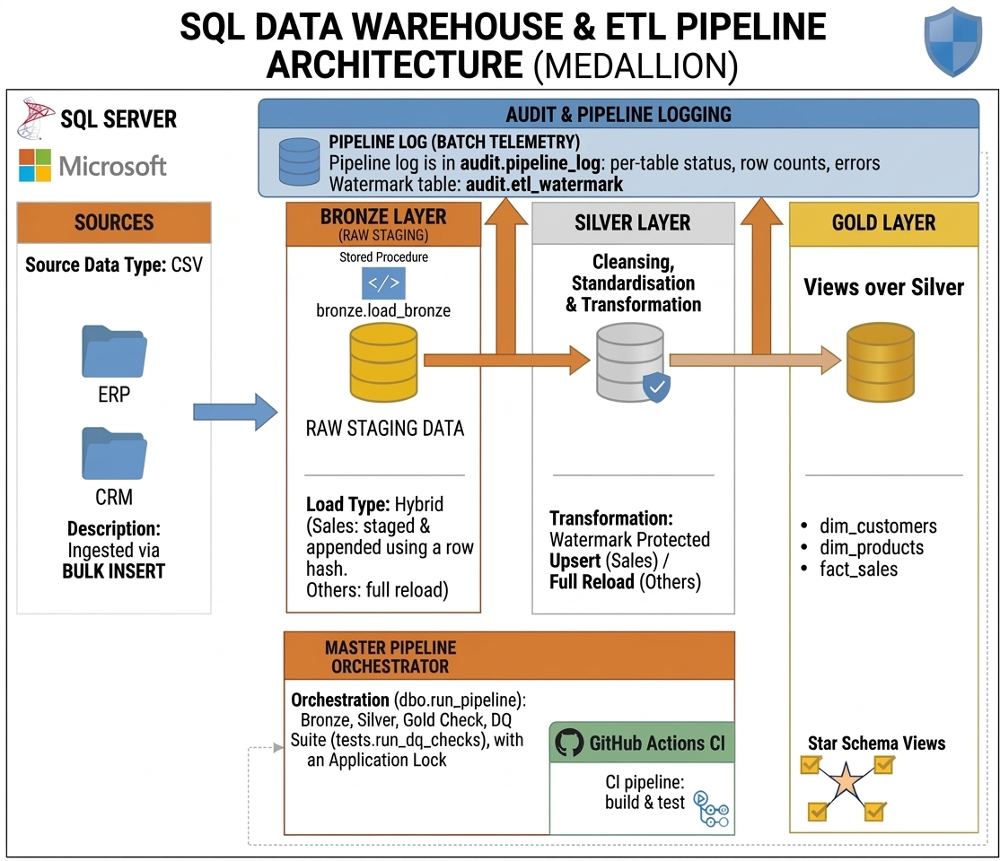

# SQL Data Warehouse and Pipeline (SQL Server, Medallion Architecture)


*A medallion data warehouse built on Microsoft SQL Server, based on
[DataWithBaraa's SQL Data Warehouse Project](https://github.com/DataWithBaraa/sql-data-warehouse-project)
and extended with incremental loading, an audit framework, an orchestration procedure, an automated data quality suite and a GitHub Actions workflow that builds and tests the whole project from an empty database.*

---

## Summary

This project consolidates CRM and ERP flat files into a single analytical model using a three-layer
**medallion architecture** (Bronze, Silver, Gold) on Microsoft SQL Server 2022.

### Credit to the base project

The following originate from Baraa's project and are used here under its MIT licence:

- the six source CSV files in `datasets/`
- the Bronze / Silver / Gold layering and the overall table design
- the Gold star-schema views and most of the cleansing rules
- the original standalone quality-check scripts in `tests/`

### What this repository adds

| Area | Base project | This project |
| :--- | :--- | :--- |
| Sales ingestion | Truncate and bulk insert | CSV is staged, then **new or changed rows are appended** to an append-only history table using a row hash. |
| Silver sales load | Truncate and reload | **Watermark-driven upsert** on the Bronze `load_id`, committed in the same transaction as the watermark update. |
| Pipeline metadata | `PRINT`-based timings | `audit.pipeline_log` (per-table status, row counts, errors) and `audit.etl_watermark`. |
| Orchestration | Run scripts manually | `dbo.run_pipeline` runs Bronze, Silver, a Gold check and the DQ suite under one batch ID, with an application lock against overlapping runs. |
| Data quality | Standalone check scripts | Standalone scripts **plus** `tests.run_dq_checks`, which raises an error on any failed assertion, including watermark reconciliation. |
| Automated build and test | None | A **GitHub Actions** workflow that builds the warehouse from scratch in a SQL Server container, runs the pipeline twice and checks the results (see [Continuous Integration](#continuous-integration)). |

Only `bronze.crm_sales_details` and `silver.crm_sales_details` use the incremental pattern. The other tables are fully reloaded on every run.

---

## Architecture



- **Bronze:** raw data loaded from CSV with `BULK INSERT`. Sales are staged (`bronze.crm_sales_details_stg`) and appended to a history table.
- **Silver:** cleansed and standardised tables. Sales are upserted incrementally; all other tables are truncated and reloaded.
- **Gold:** star-schema **views** (`gold.dim_customers`, `gold.dim_products`, `gold.fact_sales`) over Silver.

> **Scope note:** the model reflects the latest state of the data. Bronze retains versions of changed sales rows for change detection, but Gold does not provide historical (slowly changing dimension) analysis.

---

## Tech Stack

- **Database:** Microsoft SQL Server 2022 (T-SQL, stored procedures, views)
- **Runtime:** SQL Server in a Linux container (Docker Desktop with WSL 2)
- **Automation:** GitHub Actions (continuous integration)
- **Tooling:** Visual Studio Code with a T-SQL extension, Git and GitHub

---

## Repository Structure

```
├── .github/
│   └── workflows/
│       └── ci.yml                   # Continuous integration workflow
├── datasets/
│   ├── source_crm/                  # cust_info, prd_info, sales_details
│   └── source_erp/                  # CUST_AZ12, LOC_A101, PX_CAT_G1V2
├── docs/
│   ├── 01_data_catalogue.md         # Data catalogue
│   └── 02_pipeline_architecture.jpg # Pipeline diagram
├── Scripts/
│   ├── init_database.sql            # Drops and recreates DataWarehouse; creates bronze, silver, gold schemas
│   ├── 01_Bronze/                   # ddl.bronze.sql, proc_load_bronze.sql
│   ├── 02_Silver/                   # ddl_silver.sql, proc_load_silver.sql
│   ├── 03_Gold/                     # ddl_gold.sql (views)
│   ├── 04_audit/                    # audit schema, pipeline log, watermark table
│   └── 05_Orchestration/            # run_pipeline.sql
├── tests/                           # Standalone quality checks and tests.run_dq_checks
├── .gitattributes
├── .gitignore
├── LICENSE                          # MIT licence (original and derivative copyright)
└── README.md
```

---

## Setup and Run Order

Source files are read from `/var/opt/mssql/datasets/` on the SQL Server host. For a Docker container named `sqlserver`:

```bash
docker cp ./datasets sqlserver:/var/opt/mssql/
```

File names are case-sensitive on Linux (for example `CUST_AZ12.csv`).

Connect to your SQL Server instance (for example `localhost,1433`) and run the scripts **in this order**. This is the same order the CI workflow uses:

| Step | Script | Purpose |
| :-: | :--- | :--- |
| 1 | `Scripts/init_database.sql` | **Destructive reset:** drops and recreates `DataWarehouse` and the bronze, silver and gold schemas. |
| 2 | `Scripts/04_audit/01_ddl_audit.sql` | Creates the `audit` schema, `audit.pipeline_log` and logging procedures. |
| 3 | `Scripts/04_audit/02_audit.etl_watermark.sql` | Creates `audit.etl_watermark`. |
| 4 | `Scripts/01_Bronze/ddl.bronze.sql` | Creates Bronze tables. |
| 5 | `Scripts/01_Bronze/proc_load_bronze.sql` | Creates `bronze.load_bronze`. |
| 6 | `Scripts/02_Silver/ddl_silver.sql` | Creates Silver tables. |
| 7 | `Scripts/02_Silver/proc_load_silver.sql` | Creates `silver.load_silver`. |
| 8 | `Scripts/03_Gold/ddl_gold.sql` | Creates Gold views. |
| 9 | `tests/03_tests.run_dq_checks.sql` | Creates the `tests` schema and `tests.run_dq_checks`. |
| 10 | `Scripts/05_Orchestration/run_pipeline.sql` | Creates `dbo.run_pipeline`. |

Run `init_database.sql` only for first-time setup or a deliberate full reset. Then run the pipeline:

```sql
EXEC dbo.run_pipeline;                      -- normal run
EXEC dbo.run_pipeline @full_refresh = 1;    -- rebuild Silver sales from all Bronze history
```

To run the data quality suite on its own: `EXEC tests.run_dq_checks;`

> Re-running `init_database.sql` deletes everything, including the sales history and watermark. To redeploy individual layers without losing state, run only the relevant DDL and procedure scripts.

---

## Continuous Integration

Every push to `main`, every pull request and every manual run starts the workflow in `.github/workflows/ci.yml`. It proves that the project can be built from an empty database by following the documented run order, and that reruns are safe.

### What the workflow does

1. **Starts a throwaway SQL Server 2022 container** (Developer edition) on a GitHub-hosted runner and mounts the `datasets/` folder.
2. **Deploys every script in the run order above.** Any SQL error stops the build.
3. **Runs `dbo.run_pipeline`**, which loads Bronze and Silver, checks the Gold views and runs the data quality suite.
4. **Prints the load timings** from `audit.pipeline_log`.
5. **Runs the pipeline a second time with unchanged source files and asserts that:**
   - no new rows are appended to the Bronze sales history (the incremental load is repeatable);
   - `silver.crm_sales_details` and `gold.fact_sales` contain rows;
   - `audit.pipeline_log` has no `FAILED` entries;
   - customer names contain no garbled characters, which checks that accented names load correctly on Linux.
6. **On failure, prints diagnostics:** the latest audit-log entries, active SQL Server requests, row counts and the container log.

### What it does and does not cover

- It is **continuous integration only**. Nothing is deployed anywhere, so this is not continuous delivery.
- It tests the pipeline end to end against the small, static sample dataset. It does not test large volumes or changing source files.
- The `sa` password in the workflow belongs to a container that is destroyed at the end of each run. No secrets are stored in the repository.
- SQL Server Developer edition is licensed for development and testing only, which is how it is used here.

### Reproducing a CI run locally

Run the scripts in the order above, then run `EXEC dbo.run_pipeline;` twice. The second run should report `New/changed rows appended: 0`, and `SELECT COUNT(*) FROM bronze.crm_sales_details;` should return the same value after both runs.

---

## Data Quality Suite

`tests.run_dq_checks` raises error 50001 on the first failed assertion. It covers:

- **Keys and uniqueness:** no `NULL` or duplicate keys in `silver.crm_cust_info`, `silver.crm_prd_info`, `gold.dim_customers` and `gold.dim_products`.
- **Standardisation:** permitted values for gender, marital status and product line; no unwanted whitespace, prefixes or hyphens in ERP identifiers.
- **Business rules:** sales equals quantity multiplied by price; positive metrics; order date not after ship or due date; birthdate range.
- **Referential integrity:** no orphan customer or product keys in `gold.fact_sales`, and fact row count equal to Silver sales.
- **Watermark reconciliation:** the watermark is not ahead of Bronze, Silver holds nothing newer than the watermark, and Silver sales match the latest Bronze version of every business key.

The suite runs as the last step of `dbo.run_pipeline`, and therefore in every CI run. Because Gold objects are views, a failed check stops the pipeline but does not withdraw data that has already been loaded into Silver.

The standalone scripts `tests/01_quality_checks_silver.sql` and `tests/02_quality_checks_gold.sql` return rows only where a check is violated.

---

## Known Limitations

- Source deletions are not propagated; removed orders remain in Bronze history and Silver.
- Bronze sales history grows with every changed row and has no retention policy.
- Gold surrogate keys are generated with `ROW_NUMBER()` in views and are not stable across data changes.
- Gold is not materialised, and no analytics or dashboards are included.
- **Performance of the DQ suite:** the loads take a few seconds, but the pipeline takes about two minutes locally and about six minutes on a GitHub-hosted runner, so a CI run takes around twelve minutes. The audit timings show that almost all of this is the DQ suite, which queries the Gold views many times and re-evaluates them each time. Materialising the Gold views once per run has been identified as the fix but is not yet applied.
- Outside CI, the pipeline is run manually; there is no scheduler. Paths and credentials are intended for local development only.

---

## Lessons Learned

1. **Incremental design:** comparing row hashes against the latest stored version, and advancing a watermark in the same transaction as the data change, makes reruns safe. The full CSV is still read on each run, so no performance gain has been measured.
2. **Defensive T-SQL:** `TRY…CATCH`, `XACT_ABORT`, rollback on failure and error logging to an audit table make failures traceable.
3. **Reproducible environments:** a containerised SQL Server instance can be rebuilt consistently without host-level configuration.
4. **CI finds what local runs hide:** on its first run the workflow failed because one DDL script relied on the database selected in my editor instead of setting its own. Building from an empty database in a clean container exposed a bug that had never shown up locally.
5. **Measure before optimising:** the audit log showed that Bronze and Silver took about three seconds out of a 343-second run, which pointed straight at the data quality suite instead of the load logic.

---

## Licence

Released under the MIT Licence. This project is derived from work by Baraa Khatib Salkini; see `LICENSE` for both copyright notices.